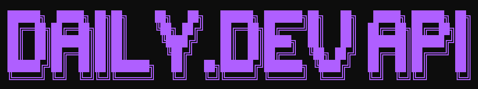
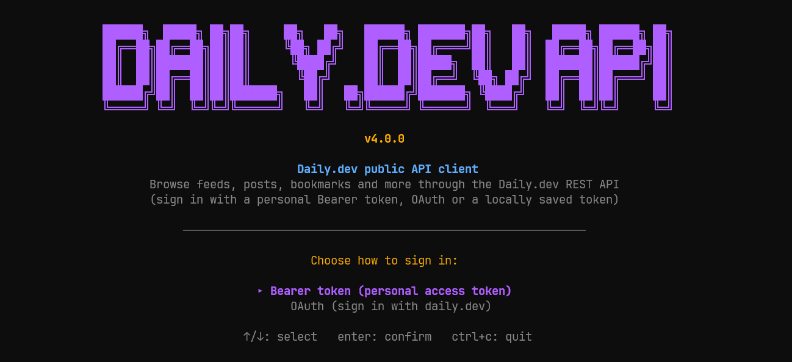
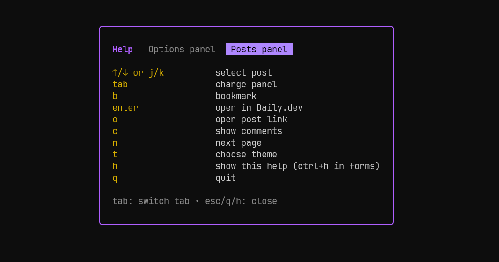
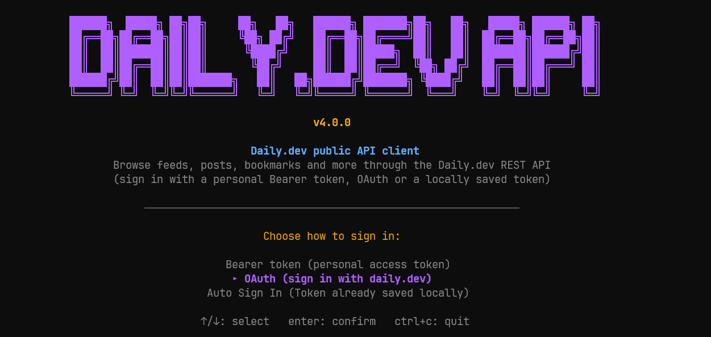
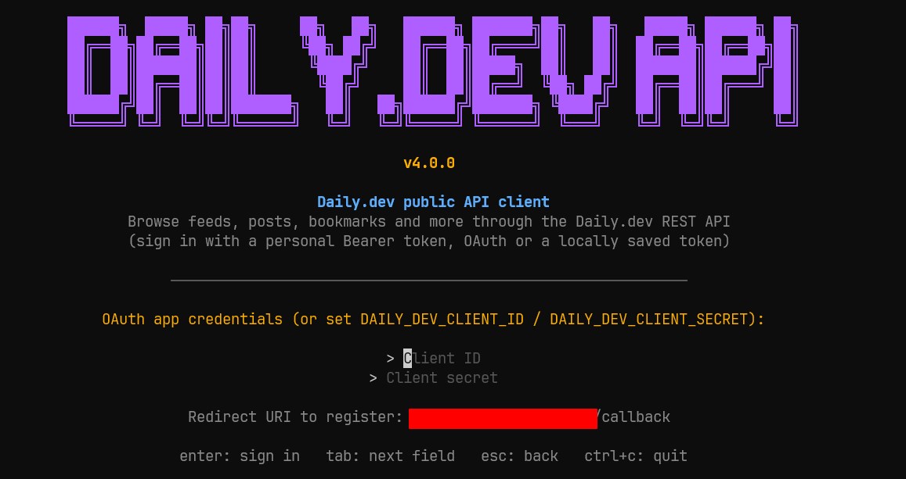
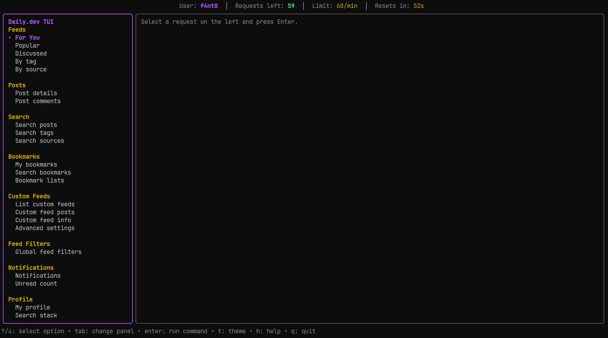
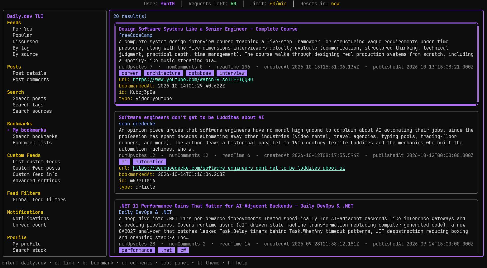
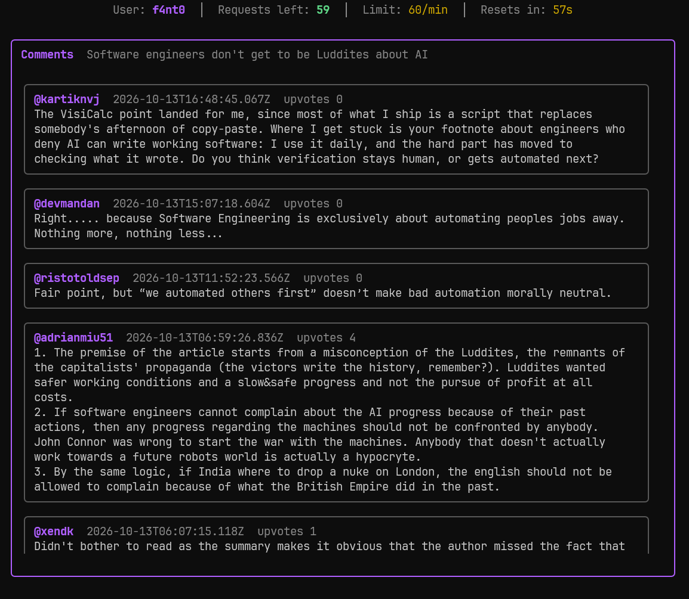
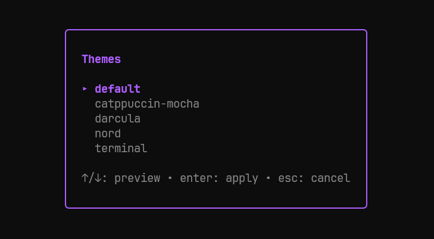

<p align="center">
  
</p>

<p align="center">
  <a href="https://github.com/F4NT0/daily-dev-tui/actions/workflows/test.yml"></a>
</p>

<p align="center">
  
  
  
  
  
  
  
</p>

---

## Quick install

Pick your system, run one command, open a new terminal and type `daily-dev`.

**Windows (PowerShell)**

```powershell
irm https://github.com/F4NT0/daily-dev-tui/releases/latest/download/daily-dev-setup.exe -OutFile $env:TEMP\daily-dev-setup.exe; & $env:TEMP\daily-dev-setup.exe
```

**Linux**

```bash
curl -fsSL https://github.com/F4NT0/daily-dev-tui/releases/latest/download/install.sh | bash
```

**macOS (Intel and Apple Silicon)**

```bash
curl -fsSL https://github.com/F4NT0/daily-dev-tui/releases/latest/download/install-macos.sh | bash
```

More details (what the installers do, options, uninstall) are in [Installation details](#installation-details).

---

## Overview

A terminal UI (TUI) for the [Daily.dev](https://app.daily.dev) public API. Browse feeds, search posts, manage bookmarks, read comments and explore developer content directly from your terminal. Written in Go with [Bubble Tea](https://github.com/charmbracelet/bubbletea).

<!-- IMAGE: overview of the main screen (menu on the left, posts on the right). Save as docs/screenshots/main-screen.png -->
<p align="center">
  
</p>

### What's new in 4.0.0

- **macOS support**: `install-macos.sh` and native builds for Intel and Apple Silicon.
- **Themes**: every color is a variable in a `.conf` file. Included: Default, Catppuccin Mocha, Nord, Terminal and Darcula. Press `t` to pick one with a live preview.
- **Two login methods**: Bearer token or OAuth (sign in with daily.dev).
- **Post selection** with bookmark (orange border), open in daily.dev, open the original link and a read-only comments panel.
- **Help panel** on `h` with the shortcuts of each panel.
- **Link fallback panel**: if no browser can be opened (for example no `xdg-open` on Linux), a floating panel shows the post and the link to open manually.
- **Automated tests** for every API call, run on each push by GitHub Actions.

---

## Keyboard shortcuts

Press `h` at any time in the menu to see these in a floating panel (inside a parameter form use `Ctrl+H`, because `h` is typed as text there).

<!-- IMAGE: the help panel (h) showing the shortcut tabs. Save as docs/screenshots/help-panel.png -->
<p align="center">
  
</p>

### Options panel (left)

| Key | Action |
|-----|--------|
| `↑/↓` | Select option |
| `Enter` | Run the selected request (opens its parameter form if it has parameters) |
| `Tab` | Change panel |
| `t` | Choose a theme |
| `h` | Show the help panel |
| `q` | Quit |

### Posts panel (results)

After a search or feed, focus moves to the results and one post is selected.

| Key | Action |
|-----|--------|
| `↑/↓` or `j/k` | Select previous / next post |
| `Enter` | Open the post on daily.dev |
| `o` | Open the original post link |
| `b` | Bookmark the post (its border turns orange) |
| `c` | Read the post comments in a floating panel |
| `n` | Next page |
| `Tab` | Change panel |
| `t` | Choose a theme |
| `h` | Show the help panel |
| `q` | Quit |

### Parameter forms and floating panels

| Where | Keys |
|-------|------|
| Parameter form | `Tab`/`↑/↓` change field, `Enter` run, `Esc` cancel, `Ctrl+H` help |
| Comments panel | `↑/↓`, `PgUp/PgDn` scroll, `Esc`/`q`/`c`/`Enter` close |
| Help panel | `Tab` or `←/→` switch tab, `Esc`/`q`/`h` close |
| Theme panel | `↑/↓` preview, `Enter` apply, `Esc` cancel |
| Login screen | `↑/↓` select method, `Enter` confirm, `Esc` back, `Ctrl+C` quit |

---

## Getting started

### 1. Choose how to sign in

The start screen lets you choose between two login methods.

<!-- IMAGE: the login method selector. Save as docs/screenshots/login-selector.png -->
<p align="center">
  
</p>

#### Bearer token (personal access token)

1. Sign in at <https://app.daily.dev>.
2. Open your account settings and find the API / Developers section.
3. Create a token and copy it immediately (API access may require Daily.dev Plus).
4. Paste it in the TUI, or set `DAILY_DEV_TOKEN` to skip the login screen entirely.

Keep the token secret and revoke it if it leaks.

#### OAuth (sign in with daily.dev)

Uses the [daily.dev OAuth flow](https://docs.daily.dev/oauth-apps/) (authorization code + PKCE). OAuth apps are in beta on daily.dev.

1. On daily.dev open **Settings > API > OAuth apps** and click **Create app**.
2. Add `http://127.0.0.1:8765/callback` as a redirect URI (it must match exactly) and copy the **Client ID** and **Client secret** (the secret is shown only once).
3. In the TUI choose **OAuth**, enter the client ID and secret (or set `DAILY_DEV_CLIENT_ID` and `DAILY_DEV_CLIENT_SECRET`).
4. The browser opens on the daily.dev consent screen. Click **Allow** and return to the terminal. If the browser does not open, copy the URL shown in the TUI.

The TUI requests `openid profile offline_access read write`, keeps the tokens in memory only and refreshes the access token automatically. If you deny `write` on the consent screen, bookmarking fails with `403 insufficient_scope`. Port `8765` on `127.0.0.1` must be free during sign-in and the attempt times out after 3 minutes. Nothing is stored on disk, so you sign in again on every start.

<!-- IMAGE: the OAuth form or the "waiting for browser" screen. Save as docs/screenshots/oauth.png -->
<p align="center">
  
</p>

### 2. Pick a request

Choose a request from the left menu (Feeds, Posts, Search, Bookmarks, Custom Feeds, Feed Filters, Notifications, Profile, Tags, Recommend). Requests with parameters open a form; required fields are marked with `*`.

<!-- IMAGE: a parameter form (for example Search posts). Save as docs/screenshots/form.png -->
<p align="center">
  
</p>

### 3. Read and act on the results

Results are shown as cards. Move between posts with `↑/↓`, then:

- **`Enter`** opens the post on daily.dev and **`o`** opens the original article.
- **`b`** adds the post to your bookmarks. The card border turns orange (a double border while selected).
- **`c`** opens a floating panel with the post comments (newest first, read-only; the public API cannot create comments).
- **`n`** loads the next page of a paginated list.
- If the browser cannot be opened, a floating panel shows the post and the link so you can open it manually.

<!-- IMAGE: results with a selected post and a bookmarked post. Save as docs/screenshots/results.png -->
<p align="center">
  
</p>

<!-- IMAGE: the comments panel. Save as docs/screenshots/comments.png -->
<p align="center">
  
</p>

`401` means the token is invalid or revoked; `429` means you are rate limited.

---

## Themes

All TUI colors are variables defined in `.conf` files inside a `themes/` directory next to the program (`%LOCALAPPDATA%\Programs\daily-dev\themes` on Windows, `~/.local/bin/themes` on Linux and macOS). When you run from a clone of the repository, `daily-dev-tui/themes/` is used. The themes are also built into the binary, so the TUI works even if the files are missing.

| Theme | File |
|-------|------|
| Default | `default.conf` |
| Catppuccin Mocha | `catppuccin-mocha.conf` |
| Nord | `nord.conf` |
| Terminal (classic green on black, uses your terminal's ANSI palette) | `terminal.conf` |
| Darcula | `darcula.conf` |

<!-- IMAGE: the theme picker (t). Save as docs/screenshots/theme-picker.png -->
<p align="center">
  
</p>

<!-- IMAGE: side by side screenshots of the themes. Save as docs/screenshots/themes.png -->
<p align="center">
  
</p>

- Press `t` in the menu to open a floating list of the themes found in `themes/`. `↑/↓` previews each theme live, `Enter` applies it and `Esc` cancels. The choice is remembered (stored in `themes/.theme`).
- Or start with `DAILY_DEV_THEME=nord` (a theme name, or a full path to a `.conf` file). The variable takes priority over the remembered choice.
- The installers never overwrite theme files that already exist, so your edits survive a reinstall.
- To create your own theme, copy any `.conf` to `themes/<name>.conf` and edit the colors. It shows up in the `t` list automatically. Missing or invalid keys fall back to the default theme.

```conf
# key = value  (ANSI 0-255 or hex #rrggbb / #rgb)
primary   = 135   # titles, banner, selected post, focused borders
secondary = 111   # post subtitle
muted     = 245   # stats, hints, footer
key       = 178   # field labels
link      = 86    # URLs
tag_fg    = 0     # tag chip text
tag_bg    = 141   # tag chip background
border    = 240   # unfocused borders
error     = 196   # errors
bookmark  = 208   # bookmarked post border
accent    = 214   # login prompts and version
info      = 75    # login tagline
```

Lines starting with `#` are comments; text after the value (separated by a space) is ignored, so inline comments work too.

---

## Commands and environment variables

| Command | Description |
|---------|-------------|
| `daily-dev` | Start the TUI. |
| `daily-dev --help` | Interactive, colored documentation (login, usage, every API request). |
| `daily-dev --version` | Print the version. |
| `daily-dev --uninstall` | Remove the command and installed files. |

| Variable | Effect |
|----------|--------|
| `DAILY_DEV_TOKEN` | API token. Skips the login screen. |
| `DAILY_DEV_CLIENT_ID`, `DAILY_DEV_CLIENT_SECRET` | OAuth app credentials; prefill the OAuth login form. |
| `DAILY_DEV_THEME` | Theme name (file `themes/<name>.conf`) or a full path to a `.conf` file. Default: `default`. |
| `DAILY_DEV_INSECURE` | Set to `1` to skip TLS verification (corporate proxies only). |
| `BROWSER` | Linux: browser command used to open links when `xdg-open` is not available. |

For the best look, use a Nerd Font such as JetBrainsMono Nerd Font in your terminal.

---

## Installation details

### Windows

Run the one-liner above, or build the installer yourself (the TUI is **not** embedded; it is fetched or built during installation):

```powershell
cd daily-dev-installer
go build -o dist\daily-dev-setup.exe .
.\dist\daily-dev-setup.exe
```

The installer first asks where `daily-dev-tui` should come from: **download the latest release** (`releases/latest/download/daily-dev-tui.exe`) or **build from a local clone** (requires Go). Then it will:

1. Create `%LOCALAPPDATA%\Programs\daily-dev`.
2. Install `daily-dev-tui.exe` and the `daily-dev` launcher there.
3. Install the themes in the `themes` folder (existing files are kept).
4. Add that directory to your user `PATH`.

### Linux

Requirements: `curl` or `wget` (x86_64 or arm64). No Go needed. The script installs the TUI to `~/.local/bin/daily-dev-tui`, creates the `daily-dev` command, downloads the themes and adds `~/.local/bin` to your `PATH` (in `~/.bashrc`, `~/.zshrc` or `~/.profile`). If links do not open, install `xdg-utils` or set `$BROWSER`.

### macOS

Requirements: macOS with `curl` (Intel or Apple Silicon). No Go needed. The script installs the binary (`darwin-amd64` or `darwin-arm64`), creates the `daily-dev` command, downloads the themes and adds `~/.local/bin` to your `PATH` (in `~/.zshrc` or `~/.bash_profile`). Links open with the system `open` command. If you download the binary with a browser instead, clear the quarantine flag with `xattr -d com.apple.quarantine daily-dev-tui`.

### Installer options (Linux and macOS)

`DAILY_DEV_INSTALL_DIR` (default `~/.local/bin`), `DAILY_DEV_REPO` (default `F4NT0/daily-dev-tui`) and `DAILY_DEV_TUI_URL` (full URL of the binary to use instead of the release).

---

## Development

### Repository layout

| Path | What it is |
|------|------------|
| `daily-dev-tui/` | The TUI client: login, menu, parameter forms and a formatted response viewer. |
| `daily-dev-tui/main.go` | Bubble Tea model: states, key handling and layout. |
| `daily-dev-tui/api.go` | HTTP client for `https://api.daily.dev/public/v1`. |
| `daily-dev-tui/endpoints.go` | The list of supported API requests and their parameters. |
| `daily-dev-tui/render.go` | Rendering of API responses (posts, tags, sources, ...). |
| `daily-dev-tui/oauth.go`, `login.go` | OAuth flow and the login screens. |
| `daily-dev-tui/theme.go`, `themes/` | Theme loading and the built-in `.conf` themes. |
| `daily-dev-installer/` | Windows installer and the `daily-dev` launcher (with the colored `--help`). |
| `install.sh`, `install-macos.sh` | Linux and macOS installers. |
| `daily_dev_search.py`, `requirements.txt` | Standalone Python search script. |

### Tests

```bash
cd daily-dev-tui
go test ./...
```

Every endpoint in `endpoints.go` is covered by a unit test against a local `httptest` server (no real token or network needed). The same tests run on every push and pull request through GitHub Actions.

### Publishing a release

Build the release files and attach them all to a GitHub release:

| Asset | Used by | How to build |
|-------|---------|--------------|
| `daily-dev-setup.exe` | Windows one-liner | `cd daily-dev-installer; go build -o dist\daily-dev-setup.exe .` |
| `daily-dev-tui.exe` | Windows installer | `cd daily-dev-tui; go build -o daily-dev-tui.exe .` |
| `install.sh` | Linux one-liner | the file at the repository root |
| `daily-dev-tui-linux-amd64` | Linux x86_64 | `GOOS=linux GOARCH=amd64 go build -o daily-dev-tui-linux-amd64 .` |
| `daily-dev-tui-linux-arm64` | Linux arm64 | `GOOS=linux GOARCH=arm64 go build -o daily-dev-tui-linux-arm64 .` |
| `install-macos.sh` | macOS one-liner | the file at the repository root |
| `daily-dev-tui-darwin-amd64` | macOS Intel | `GOOS=darwin GOARCH=amd64 go build -o daily-dev-tui-darwin-amd64 .` |
| `daily-dev-tui-darwin-arm64` | macOS Apple Silicon | `GOOS=darwin GOARCH=arm64 go build -o daily-dev-tui-darwin-arm64 .` |
| `default.conf`, `catppuccin-mocha.conf`, `nord.conf`, `terminal.conf`, `darcula.conf` | Themes (downloaded by the Linux and macOS installers) | the files in `daily-dev-tui/themes/` |

The `go build` commands for the TUI run inside `daily-dev-tui/`.

---

## Support the project

If this tool is useful to you, you can support its development:

<!-- Replace the URL below with your Buy Me a Coffee page -->
<p align="center">
  <a href="https://www.buymeacoffee.com/YOUR_USERNAME">
    
  </a>
</p>

<p align="center">Made by <a href="https://github.com/F4NT0">F4NT0</a></p>
